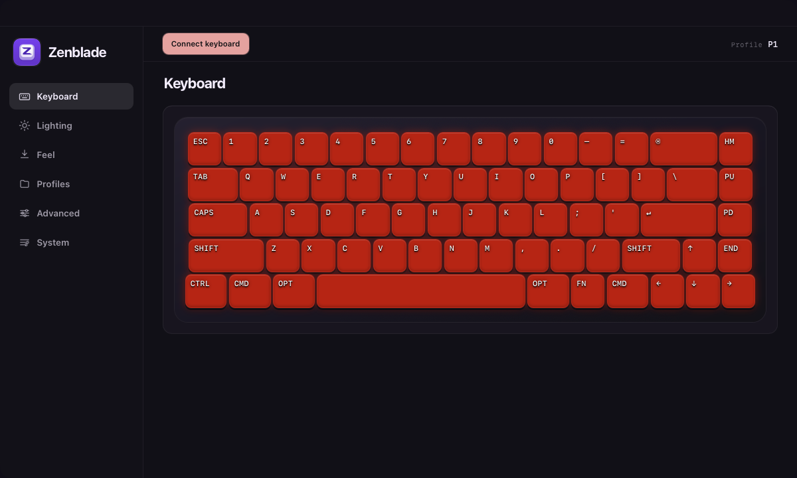
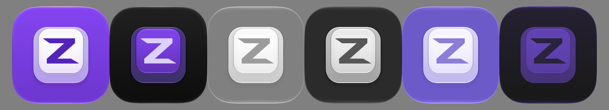
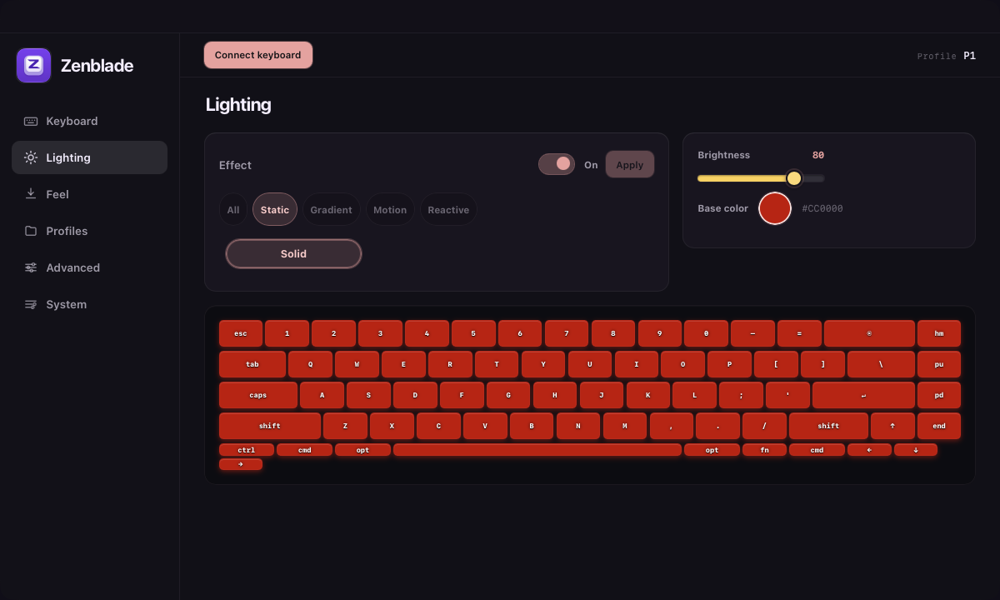
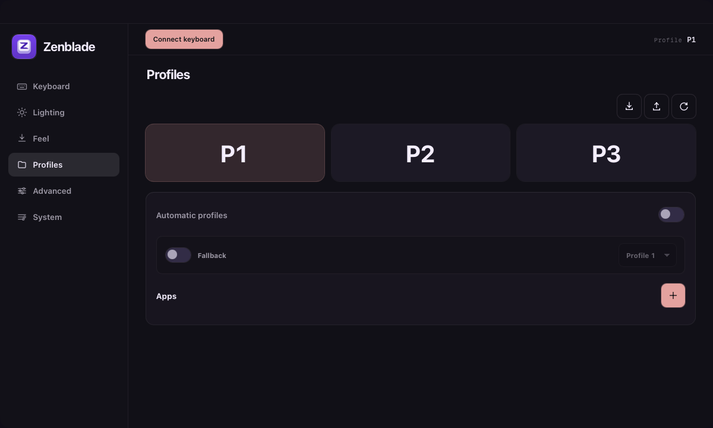
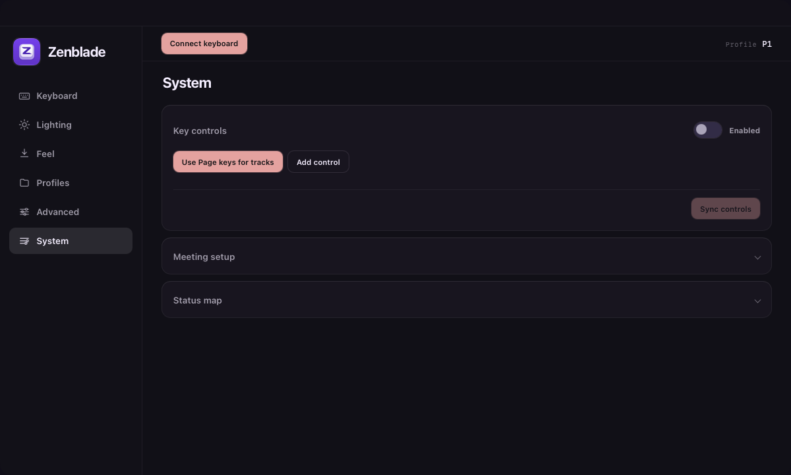

# Zenblade for macOS

A free, open-source controller for the **Pwnage Zenblade 65 V2**. Adjust your keyboard’s lighting, key response, and profiles directly from your Mac.

**[Download V0.2](https://edgetr.github.io/Zenblade-65-V2-MacOS-App/)** · [User guide](docs/USAGE.md) · [Report an issue](https://github.com/edgetr/Zenblade-65-V2-MacOS-App/issues)



## What it does

- **Lighting:** firmware effects, brightness, speed, color, and a live preview.
- **Key response:** global actuation, Rapid Trigger, and individual key overrides.
- **Profiles:** three independent setups, app-based switching, and import/export.
- **Onboard controls:** six remapping layers, SOCD pairs, and sixteen macro slots.
- **Mac controls:** media keys, microphone shortcuts, and audio device presets.
- **Menu bar:** switch profiles, toggle lighting, and reconnect without opening the window.
- **Updates:** new versions install from inside the app (Zenblade → Check for Updates…).

Settings remain editable while disconnected. System status maps are **app previews only**; the current firmware does not expose per-key RGB output.

## Install

1. Download **[Zenblade-0.2.1-arm64.dmg](https://github.com/edgetr/Zenblade-65-V2-MacOS-App/releases/latest/download/Zenblade-0.2.1-arm64.dmg)** from the [latest release](https://github.com/edgetr/Zenblade-65-V2-MacOS-App/releases/latest).
2. Open the DMG and drag **Zenblade** to **Applications**.
3. Try opening Zenblade. If macOS blocks it, go to **System Settings → Privacy & Security → Open Anyway**, then confirm **Open**. On macOS 12, use **System Preferences → Security & Privacy**.
4. Connect your keyboard over USB and select **Connect keyboard**.

After that, Zenblade checks for new versions and offers to install them; you don't need to download a DMG again. Upgrading from V0.1 keeps your profiles.

**Requires an Apple-silicon Mac and macOS 12 or newer.** This release does not include an Intel build. Only the Zenblade 65 V2 is supported.

This community build is ad-hoc signed and **not notarized by Apple**. Only approve a download you trust. The release includes a SHA-256 checksum. [Apple’s first-launch guidance](https://support.apple.com/en-gb/102445).

No developer tools are needed for the DMG. macOS 12 is the build target; this release was exercised on the maintainer’s current Mac, not every supported macOS version.

## Built with Rust and Tauri

V0.2 replaced the Electron shell with a native Rust app built on [Tauri](https://tauri.app). The interface and keyboard protocol are unchanged; the app now uses the WebKit built into macOS instead of shipping its own copy of Chromium.

Measured on the same Apple-silicon Mac with the keyboard connected (V0.1 Electron → V0.2 Tauri):

| | Electron (V0.1) | Rust + Tauri (V0.2) |
| --- | --- | --- |
| App size on disk | 285 MB | **12 MB** (−96%) |
| Memory, total footprint of all app processes | 176 MB | **102 MB** (−42%) |
| Memory, resident (RSS) | 471 MB | **234 MB** (−50%) |
| Idle CPU, incl. audio-status helper | 0.46 s / 30 s | **0.36 s / 30 s** (−22%) |
| Keyboard command round trip | 2.03 ms | **2.00 ms** (same) |
| Launch to window | ~0.6 s | ~0.6 s (same) |

The keyboard itself is the speed limit for applying settings, so commands take the same time; the gains are in disk space, memory and background cost.



## A quieter workspace

The interface keeps connection controls available across pages, removes repeated explanations, and puts advanced editors behind expandable sections.

### Lighting



### Profiles



### Mac controls



Screenshots show the app in offline editing mode with default settings. See the [user guide](docs/USAGE.md) for setup and feature details.

## Build from source

Requires [Rust](https://rustup.rs), Node.js 22.12+, and Xcode 27 or newer on an Apple-silicon Mac. Full Xcode compiles the Icon Composer asset; running from source with `npm start` only needs Command Line Tools.

```bash
git clone https://github.com/edgetr/Zenblade-65-V2-MacOS-App.git
cd Zenblade-65-V2-MacOS-App
npm ci
npm test
npm run build
```

The app is written to `src-tauri/target.nosync/release/bundle/macos/Zenblade.app`.

| Command | Purpose |
| --- | --- |
| `npm start` | Run from source (View → Toggle Developer Tools for the inspector) |
| `npm test` | Run the JavaScript and Rust test suites |
| `npm run build:icons` | Compile the layered icon and Apple-grid fallbacks |
| `npm run build` | Build the Apple-silicon application |
| `npm run install-app` | Build, replace the local Applications copy, and open it |
| `npm run release` | Build the DMG, checksum, signed update and `latest.json` into `dist/` |
| `npm run release:publish` | Do the above and publish the GitHub release |

[Architecture and contribution guide](docs/DEVELOPMENT.md) · [V0.2.1 release notes](docs/releases/v0.2.1.md) · [V0.2 release notes](docs/releases/v0.2.0.md) · [V0.1 release notes](docs/releases/v0.1.md)

## Review the code and give feedback

The complete source and [security notes](SECURITY.md) are public. Review them or [build from source](#build-from-source) if you prefer not to trust a prebuilt download. The release includes a checksum.

What would you like added? Leave a comment on the announcement or [open a feature request](https://github.com/edgetr/Zenblade-65-V2-MacOS-App/issues).

## Community project

Zenblade is independent and is not affiliated with or endorsed by Pwnage. Audio inspection, process matching, and profile settings stay local to your Mac.

To uninstall, quit Zenblade from its menu and remove `/Applications/Zenblade.app`. Saved settings remain in `~/Library/WebKit/com.local.zenblade` (and, after upgrading from V0.1, `~/Library/Application Support/Zenblade`) unless removed separately.

[MIT License](LICENSE)
