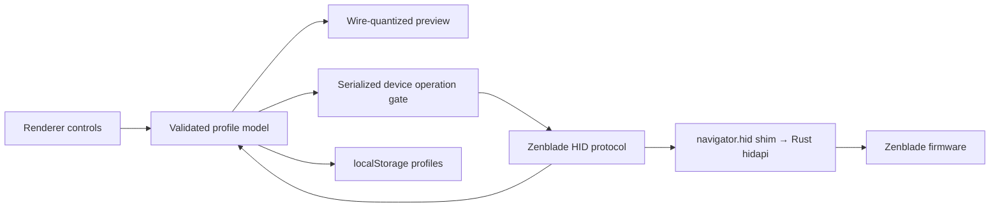

# Architecture and contributing

Zenblade is a Rust + [Tauri 2](https://tauri.app) application. The native host is Rust; the interface is plain HTML/CSS/JavaScript with no renderer framework, rendered by the system WebKit (no bundled browser engine).

| Area | Main files | Responsibility |
| --- | --- | --- |
| Native host | `src-tauri/src/lib.rs`, `menu.rs`, `commands.rs`, `desktop.rs` | Window/menu-bar lifecycle, macOS menu, file dialogs, foreground-app metadata, local process matching, global shortcuts |
| HID transport | `src-tauri/src/hid.rs`, `renderer/js/native-shell.js` | hidapi access limited to supported vendor interfaces, hot-plug monitor, and a WebHID-compatible `navigator.hid` for the protocol code |
| macOS integration | `src-tauri/src/audio.rs`, `observers.rs`, `webkit.rs` | In-process CoreAudio routing and microphone mute, sleep/wake/unlock and app-activation notifications, full-speed timers while the window is hidden |
| Updates and data | `src-tauri/src/updater.rs`, `migrate.rs` | Signed in-app updates from GitHub Releases; one-time import of profiles saved by the Electron builds |
| Renderer bridge | `renderer/js/native-shell.js` | `window.zenShell` (desktop commands and events) and window-title sync |
| App orchestration | `renderer/js/app.js`, `renderer/js/bootstrap-ui.js`, `renderer/js/desktop-controller.js` | Connect/recovery flow, app-aware switching, tray state, operation gating, navigation, top-level UI synchronization |
| HID protocol | `renderer/js/protocol.js`, `shared/device-ids.json` | Device filtering, command queue, 8 × 9 matrix packing, lighting/profile/actuation, remapping, SOCD, and macro reads/writes |
| State and persistence | `renderer/js/state.js`, `renderer/js/store.js` | Profile model, validation, migration, debounced `localStorage` persistence |
| Lighting | `renderer/js/lighting-modes.js`, `lighting-ui.js`, `lighting-preview.js`, `preview.js` | Fixed firmware IDs, control visibility, wire-quantized colors, effect preview recipes |
| Keyboard and feel | `renderer/js/board.js`, `key-editor.js`, `layout.js`, `device-ops.js` | 68-key layout, responsive rendering, per-key overrides, full 72-cell firmware matrices |
| Advanced controls | `renderer/js/advanced-ui.js`, `advanced-data.js` | Keyboard-first remapping, SOCD pairs, macro recording, and hardware read-back verification |
| System controls | `renderer/js/system-ui.js`, `system-data.js` | Per-profile media mappings, audio scenes, process/microphone context, status composition, and deterministic key restoration |
| Presentation | `renderer/index.html`, `renderer/css/` | Accessible semantic controls and native macOS-oriented visual styling |
| Tests | `test/*.test.js`, `src-tauri/src/**` `#[cfg(test)]` | Model boundaries, HID packing/matching, mode integrity, preview behavior, bridge contract, native validation and security boundaries |



### Important invariants for contributors and coding agents

- Lighting firmware IDs are wire values. Never renumber them when hiding an unsupported UI option.
- Lighting writes intentionally send both command families `7` and `9` for v1/v2 and v3 compatibility.
- Rich HID responses must match the complete command prefix; matching only the first byte can resolve the wrong queued command.
- Actuation writes translate 68 logical keys into the firmware's full 72-cell matrix. Preserve `LOGICAL_MATRIX_POSITIONS`, `CODE_TO_MATRIX_INDEX`, and their round-trip tests.
- Keep hardware work inside `DeviceOperationGate` so overlapping writes cannot corrupt the command queue.
- Keep System key ownership limited to Home/Page Up/Page Down/End, and restore all four deterministically when the feature is paused.
- Do not claim physical per-key status lighting unless a verified framebuffer protocol is added. Whole-board color replacement is not an acceptable fallback.
- Native commands are listed in `src-tauri/build.rs` and granted only to the main window in `src-tauri/capabilities/main.json`; every command also re-checks that it was called from the bundled page. Do not expose Tauri plugin JavaScript APIs (fs, shell, …) to the page. The CSP in `tauri.conf.json` must allow bundled JSON module imports and IPC (`connect-src 'self' ipc: http://ipc.localhost`).
- `hid.rs` only exposes vendor-defined interfaces of the IDs in `shared/device-ids.json` and opens them non-exclusively. Never open the typing interface (it would require Input Monitoring).
- `native-shell.js` keeps the WebHID and preload contracts the renderer was written against; `test/native-shell.test.js` pins them.
- Previews should use the same wire conversions as device writes. Do not add cosmetic brightness floors or color whitening to the key fill.
- Preserve unknown legacy profile fields when practical so upgrades do not destroy local user data.

## Making changes

Before opening a pull request or handing a branch back to another agent:

```bash
git diff --check
npm test        # Node tests + cargo test
npm run build   # src-tauri/target.nosync/release/bundle/macos/Zenblade.app
```

Requirements: Rust (via rustup), Node.js 22.12+, and Xcode 27+ for the icon catalog. Cargo writes to `src-tauri/target.nosync` so a checkout inside iCloud Desktop/Documents is never uploaded.

For UI changes, also launch the packaged build and inspect every affected page at the minimum supported window size.

### Scripted UI checks

`cargo build --features e2e` (in `src-tauri/`) builds a test-only binary that forwards the page console to stdout and runs a script from `ZEN_E2E_SCRIPT` after load. `ZEN_E2E_TEST_MODE=1` opens the page with `?test`, which exposes `window.__zenTest`; `e2e_snapshot` writes window screenshots to `ZEN_E2E_OUT`. The feature is never part of release builds. For protocol changes, test with a real keyboard and keep packets or reproducible observations with the change description.

An effective prompt for a coding agent should point it to this Architecture section, name the relevant subsystem, state whether hardware behavior may change, and require tests plus a build. Avoid asking an agent to guess new firmware IDs or effects without device evidence.


## Releases and in-app updates

Installed apps check `https://github.com/edgetr/Zenblade-65-V2-MacOS-App/releases/latest/download/latest.json` shortly after launch and then daily, and from **Zenblade → Check for Updates…**. They only install a bundle whose minisign signature matches the public key in `src-tauri/tauri.conf.json`.

To ship a version:

1. Bump `version` in `package.json` (Cargo and the bundle read it from there).
2. Add `docs/releases/v<version>.md`; its text becomes the GitHub release notes and the in-app update notes.
3. Run `npm run release` to build `dist/Zenblade-<version>-arm64.dmg`, its checksum, the signed `…app.tar.gz` update and `latest.json`. Check them, then `npm run release:publish` creates the GitHub release with all of them.

Signing uses `~/.tauri/zenblade-updater.key` (or `TAURI_SIGNING_PRIVATE_KEY`). Keep that key private and backed up: without it, installed copies cannot be updated and users must reinstall from a DMG.

After `npm run release`, `npm run preview:release` serves the DMG from `http://127.0.0.1:8765` for a local check. The DMG layout (`build/dmg-background.png`, icon positions) is configured under `bundle.macOS.dmg` in `tauri.conf.json`.

## App icon

The icon is an Icon Composer document at `build/icon-source/Zenblade.icon`: a glass keycap with a blade-tipped Z, as three SVG layers in two groups. It is designed for the Liquid Glass appearances (Default, Dark, Clear, Tinted); the legend has a lighter Dark-mode fill.

`npm run build:icons` (Xcode 27+) compiles `build/Assets.car` with `actool`, renders the default appearance with `ictool`, and derives the Apple-grid fallbacks (824 pt shape centred on a 1024 canvas with the template shadow) for `build/icon.png` and `build/icon.icns`, plus the sidebar and website icons. The bundle sets `CFBundleIconName = Zenblade`, so macOS 26+ uses the layered catalog and older systems use the ICNS.
